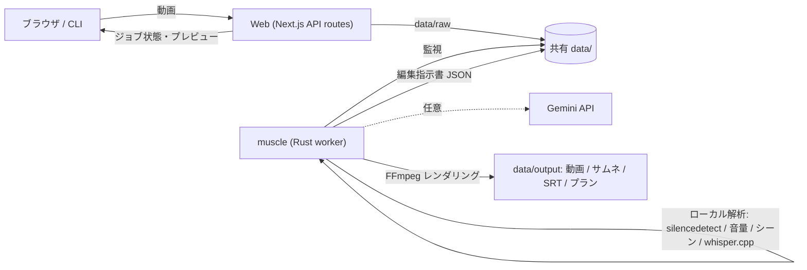

# Nue (鵺) - AI Video Alchemy Platform 🧪


-magenta?logo=google-gemini)
[](https://enludus.vercel.app)

[English](README.md)

**Nue (鵺)** は、撮ったままの動画を、ショート動画/YouTube向けに自動編集するツールです。
無音カット、字幕、テロップ、効果音、BGMのダッキング、アイコン演出、縦型リフレーム、サムネイルまでを1コマンドで仕上げます。

**APIキーは不要です。** 解析はすべてローカル（FFmpeg + whisper.cpp）で完結し、Gemini APIキーを設定したときだけ、映像の意味まで読んだ編集判断を追加で使います。

---

## 🚀 できること

| 機能 | 内容 | 必要なもの |
| --- | --- | --- |
| ジャンプカット | 無音の間を検出して削除（前後に余白を残す） | なし |
| 字幕生成 | 音声を文字起こしして焼き込み + `.srt` 書き出し | whisper.cppモデル（Docker版は同梱） |
| テロップ | 台本の `00:00:15 - ここがポイント！` 形式の行や手動指定を、色付き・箱付きで表示 | なし |
| 効果音 | 音量ピークに `impact`、シーン切替に `whoosh`。手動/Geminiで `pop` `ding` `boing` `buzzer` `sparkle` も | なし（`data/se` 同梱） |
| アイコン演出 | `exclaim` `question` `heart` `star` `sparkle` `sweat` `check` `cross` `arrow` `fire` | なし（`data/icons` 同梱） |
| ズーム/パン | 盛り上がりでパンチズーム、手動で `zoom_in` `zoom_out` `pan_left` `pan_right` | なし |
| BGM | 話し声に合わせて自動で音量を下げる（サイドチェーン・ダッキング） | `data/bgm` |
| 書き出し形式 | 縦 9:16 / 横 16:9 / 正方形 1:1 | なし |
| サムネイル | 盛り上がりのフレーム + タイトル文字 | なし |
| AI編集判断 | 面白いシーン選び、言い直しの除去、被写体位置でのクロップ、テロップ文言 | `GEMINI_API_KEY`（任意） |

## 🛠 アーキテクチャ



| サービス | 技術 | 役割 |
| --- | --- | --- |
| **muscle** | Rust | CLI兼ワーカー。解析（ローカル/Gemini）→ 編集指示書JSON → FFmpegで書き出し |
| **web** | Next.js | アップロード、詳細オプション、進捗表示、プレビュー、ダウンロード |

すべての解析結果は [編集指示書JSON](docs/edit-plan.schema.json) に落ちます。手で直して `muscle render` すれば再書き出しでき、将来のiOS版とも同じ形式を共有します（[docs/mobile-strategy.md](docs/mobile-strategy.md)）。

---

## ⚡ クイックスタート (Docker)

```bash
git clone https://github.com/naki0227/nue.git
cd nue
cp .env.example .env        # Geminiを使う場合だけ GEMINI_API_KEY を設定
docker compose up -d --build
```

[http://localhost:3000](http://localhost:3000) を開いて動画をドロップすると、自動で編集が始まります。
完成後は「Edit」でカット・テロップ・字幕・効果音・ズーム・アイコンを直して「Re-render」で再書き出しできます。動画・サムネイル・字幕(.srt)・編集指示書は画面からダウンロードでき、`data/output/` にも保存されます。

字幕用のwhisperモデルは既定で `base` を同梱します。日本語の精度を上げたい場合は `.env` に `WHISPER_MODEL=small`（または `medium`）を設定して再ビルドしてください。`none` にすると字幕生成をスキップします。

## 💻 CLI

```bash
cd muscle && cargo build --release
./target/release/muscle run input.mp4 --out final.mp4
```

```text
muscle analyze <video> [--out plan.json] [options]   編集指示書を作る
muscle render <plan.json> [--out video.mp4]          編集指示書から書き出す（手修正後の再書き出しにも）
muscle run <video> [--out video.mp4] [options]       analyze -> render を一括
muscle worker                                        data/raw を監視して自動処理（Docker既定）

--analyzer auto|local|gemini   --format vertical|horizontal|square
--script notes.txt             --meta job.json
--no-bgm  --no-se  --no-subtitles  --no-jump-cut
```

必要なもの: `ffmpeg` / `ffprobe`、日本語フォント（Noto Sans CJK推奨、`NUE_FONT` で指定可）。
字幕を作るには [whisper.cpp](https://github.com/ggml-org/whisper.cpp) の `whisper-cli` とモデル（`data/models/ggml-*.bin` に置くか `NUE_WHISPER_MODEL` で指定）。動画と同じ名前の `.srt` を横に置けば、それを字幕として使います。

| 環境変数 | 説明 |
| --- | --- |
| `NUE_DATA_DIR` | データディレクトリ（既定: `/app/data` か `./data`） |
| `NUE_ANALYZER` | 既定の解析方法 `auto` / `local` / `gemini` |
| `GEMINI_API_KEY` / `GEMINI_MODEL` | Geminiを使う場合 |
| `NUE_WHISPER_MODEL` / `NUE_WHISPER_BIN` / `NUE_LANGUAGE` | 字幕生成（言語の既定は `auto`、例: `ja`） |
| `NUE_FONT` | テロップ・字幕のフォント |
| `NUE_X264_PRESET` | エンコード速度（既定 `veryfast`） |

## 🎨 アセットを増やす

- 効果音: `data/se/<名前>.wav|mp3` を置くと、その名前を `se_events[].type` に使えます（`scripts/generate-sound-effects.sh` で同梱音を再生成）
- アイコン: `data/icons/<名前>.png`（透過PNG）を置くと `overlays[].asset` に使えます（`scripts/generate_icons.py` で同梱アイコンを再生成）
- BGM: `data/bgm/` に置くと、ムード名（`calm`、`energetic` など）を含むファイルが優先されます

---

## ❓ トラブルシューティング

- **字幕が出ない**: ログに `No whisper model found` が出ていればモデル未配置です。Docker版は `WHISPER_MODEL` を `none` 以外にして再ビルドしてください
- **日本語が豆腐(□)になる**: 日本語フォントを入れるか `NUE_FONT` でフォントファイルを指定してください
- **Geminiでエラー**: 自動でローカル解析にフォールバックして書き出しは続きます。キーや無料枠を確認してください
- **アップロードが進まない**: ディスク容量を確認してください（`docker system prune`）

## 📈 ロードマップ

- [x] MVP、基本編集（カット、トランジション）
- [x] 音響（ダッキング、効果音自動挿入）、ズーム/パン、サムネイル、縦型対応、テロップ装飾、Web UI
- [x] Rust CLI + Next.js の2サービス化（Go Gateway / Python Brain を廃止）
- [x] APIキー不要のローカル解析（無音カット・音量ピーク・シーン検出）
- [x] オンデバイス字幕生成（whisper.cpp）と SRT 書き出し
- [x] 効果音・アイコンアセット、横/正方形書き出し
- [x] Webでの編集指示書タイムライン手修正（カット・テロップ・字幕・効果音・ズーム・アイコン）→ 再書き出し
- [ ] iOSアプリ（Apple Intelligence + Speech/Vision/SoundAnalysis + AVFoundation）
- [ ] ユーザー認証 & マルチユーザー対応

## 🧭 設計ドキュメント

- [`docs/mobile-strategy.md`](docs/mobile-strategy.md): API AI / Apple Intelligence / スマホ化 / Remotion / Go の判断
- [`docs/edit-plan.schema.json`](docs/edit-plan.schema.json): 編集指示書のスキーマ
- [`docs/language-strategy.md`](docs/language-strategy.md): 言語構成の判断理由
- [`docs/migration-plan.md`](docs/migration-plan.md): Rust + Next.js への移行記録
- [`docs/roi.md`](docs/roi.md): 時間/コスト削減の仮説と成功指標

## 📄 ライセンス

MIT License. 同梱の効果音・アイコンはこのリポジトリのスクリプトで生成したオリジナル素材です。
