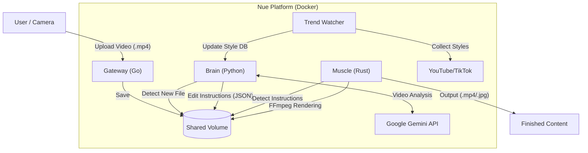

# Nue - AI Video Alchemy Platform 🧪


[](https://enludus.vercel.app)

<p align="center">
  <b>"Automated Video Processing Platform turning raw footage into YouTube-ready content."</b>
</p>

---

[🇯🇵 Japanese (日本語)](README.ja.md)

## 📖 The "Why"

In video production, editing is the biggest barrier.
*   **The Problem:** It often takes over 2 hours to cut, caption, and adjust audio for just a 10-minute video.
*   **The Solution:** Nue acts as your personal "AI Editor". It understands the content (funny scenes, serious moments, shocking events) and fully automates BGM selection, digital zoom effects, and even vertical crops for Shorts.

## 🚀 Key Features

### 🧠 Brain (Trend Analysis & Direction)
*   **Style Cloning:** Analyzes and learns trending Vlog styles (tempo, filters, music) from YouTube and TikTok.
*   **Semantic Analysis:** Uses **Gemini 2.5 Flash** to understand not just visual changes but the context of "what is happening".
*   **AI Thumbnails:** Identifies the most "Clickbaity" moments and generates thumbnails with catchy titles.

### 💪 Muscle (High-Speed Rendering)
*   **Rust + FFmpeg:** Efficiently builds and executes complex FFmpeg filter graphs using a concurrent architecture in Rust.
*   **Visual Effects:**
    *   **Digital Zoom:** Applies "Ken Burns" effects to static shots or impact zooms to shocking moments.
    *   **Smart Crop:** Automatically detects the subject and crops 16:9 video to 9:16 for Shorts.
*   **Audio Engineering:**
    *   **Auto Ducking:** Automatically lowers BGM volume when speech is detected.
    *   **Reaction SE:** Inserts appropriate sound effects (laughter, shock sounds) at the perfect timing.

---

## 🛠 Architecture

Nue adopts a microservice architecture optimized for local execution via Docker Compose, but easily deployable to AWS or GCP.



## 💻 Tech Stack

| Service | Technology | Role |
|:---|:---|:---|
| **Gateway** | **Go (Gin)** | Extremely fast, low-memory upload server. |
| **Brain** | **Python 3.11** | Core AI Logic. Handles Gemini SDK, file monitoring, and trend analysis. |
| **Muscle** | **Rust** | Heavy lifting. Generates and runs complex FFmpeg filter chains. |
| **Infra** | **Docker Compose** | Orchestration of all services and shared volume (`/data`). |

---

## ⚡ Quick Start

### Prerequisites
*   Docker Desktop
*   Google Gemini API Key

### Installation 🛠️

Designed for anyone to start easily.

1.  **Clone the Repository**
    ```bash
    git clone https://github.com/naki0227/nue.git
    cd nue
    ```

2.  **Environment Setup**
    Copy `.env.example` to `.env` and set your Google Gemini API Key.
    ```bash
    cp .env.example .env
    ```

3.  **Start (Docker Compose)**
    ```bash
    docker compose up -d --build
    ```

4.  **Access Web UI**
    Open [http://localhost:3000](http://localhost:3000) in your browser.
    Drag and drop video files to start automatic editing.

---

## 📉 Roadmap

> Nue is being migrated toward a Rust CLI + Next.js Web UI architecture. See [`docs/migration-plan.md`](docs/migration-plan.md) and [`docs/language-strategy.md`](docs/language-strategy.md) for the current plan.

- [x] **Phase 1-2**: MVP Architecture & Basic Editing (Cut, Transition)
- [x] **Phase 3**: Trend Analysis & Learning Engine
- [x] **Phase 6**: Audio Engineering (Ducking, Auto SE)
- [x] **Phase 7**: Visual Effects (Zoom/Pan)
- [x] **Phase 8**: Auto Thumbnail Generation
- [x] **Phase 9**: Automation & QA (GitHub Actions)
- [x] **Phase 10**: Vertical Video Support (Smart Crop)
- [x] **Phase 11**: Advanced Caption Styling
- [x] **Phase 12**: Web Interface (Next.js)
- [ ] **Phase 13**: User Auth & Multi-user Support (Future)

---

## 🧭 Planning Docs

- [`docs/migration-plan.md`](docs/migration-plan.md): staged migration from Go/Python toward Rust CLI + Next.js
- [`docs/language-strategy.md`](docs/language-strategy.md): language-boundary rationale
- [`docs/roi.md`](docs/roi.md): time/cost-saving assumptions and success metrics

---

## 🤝 Contribution
Contributions are welcome! Please check `CONTRIBUTING.md` for details.

## 📄 License
This project is licensed under the MIT License.
