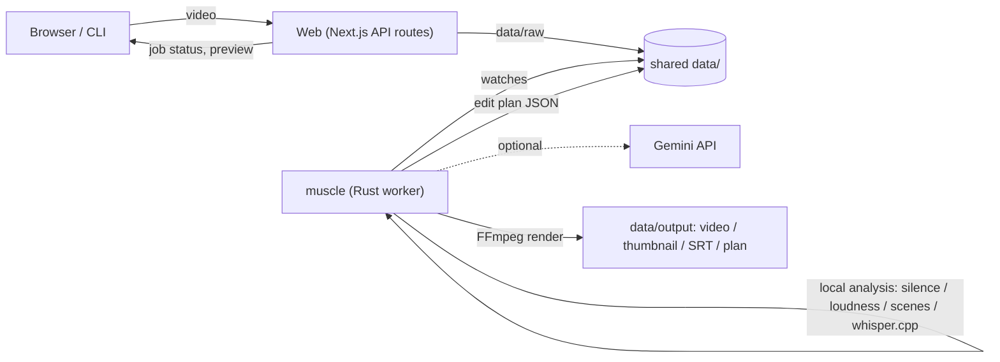

# Nue (鵺) - AI Video Alchemy Platform 🧪


-magenta?logo=google-gemini)
[](https://enludus.com)

[日本語](README.ja.md)

**Nue** turns raw footage into a finished short or YouTube video: jump cuts, subtitles, telops, sound effects, ducked background music, sticker icons, vertical reframing and a thumbnail, in one command.

**No API key required.** Analysis runs locally (FFmpeg + whisper.cpp). Set a Gemini API key only if you want an AI editor that understands what is on screen.

---

## 🚀 Features

| Feature | What it does | Needs |
| --- | --- | --- |
| Jump cuts | Detects and removes silent pauses (with breathing room) | nothing |
| Subtitles | Transcribes speech, burns it in, writes an `.srt` | whisper.cpp model (bundled in Docker) |
| Telops | Script lines like `00:00:15 - Key point!` or manual captions, styled | nothing |
| Sound effects | `impact` on loudness peaks, `whoosh` on scene changes; `pop` `ding` `boing` `buzzer` `sparkle` manually or via Gemini | nothing (`data/se`) |
| Sticker icons | `exclaim` `question` `heart` `star` `sparkle` `sweat` `check` `cross` `arrow` `fire` | nothing (`data/icons`) |
| Zoom / pan | Punch-in on highlights; manual `zoom_in` `zoom_out` `pan_left` `pan_right` | nothing |
| BGM | Sidechain ducking under speech | `data/bgm` |
| Output formats | Vertical 9:16, horizontal 16:9, square 1:1 | nothing |
| Thumbnail | Highlight frame + title | nothing |
| AI editing | Picks the best moments, drops retakes, reframes on the subject, writes telops | `GEMINI_API_KEY` (optional) |

## 🛠 Architecture



| Service | Tech | Role |
| --- | --- | --- |
| **muscle** | Rust | CLI and worker: analyze (local or Gemini) → edit plan JSON → FFmpeg render |
| **web** | Next.js | Upload, options, progress, preview, plan editing, downloads |
| **ios** | Swift (SwiftUI + NueKit) | Analyze and render on iPhone/iPad, no server or API |

Every analyzer writes the same [edit plan JSON](docs/edit-plan.schema.json). Edit it by hand and run `muscle render` to re-render; a future iOS client shares the same format ([docs/mobile-strategy.md](docs/mobile-strategy.md)).

---

## ⚡ Quick start (Docker)

```bash
git clone https://github.com/naki0227/nue.git
cd nue
cp .env.example .env        # set GEMINI_API_KEY only if you want Gemini
docker compose up -d --build
```

Open [http://localhost:3000](http://localhost:3000) and drop a video. After it finishes, click **Edit** to adjust cuts, telops, subtitles, sound effects, zoom and icons, then **Re-render**. The finished video, thumbnail, subtitles (.srt) and edit plan can be downloaded from the page and are saved in `data/output/`.

The image bundles the `base` whisper model. For better accuracy set `WHISPER_MODEL=small` (or `medium`) in `.env` and rebuild; `none` skips subtitles.

## 💻 CLI

```bash
cd muscle && cargo build --release
./target/release/muscle run input.mp4 --out final.mp4
```

```text
muscle analyze <video> [--out plan.json] [options]   create an edit plan
muscle render <plan.json> [--out video.mp4]          render a (hand-edited) plan
muscle run <video> [--out video.mp4] [options]       analyze -> render
muscle worker                                        watch data/raw (Docker default)

--analyzer auto|local|gemini   --format vertical|horizontal|square
--script notes.txt             --meta job.json
--no-bgm  --no-se  --no-subtitles  --no-jump-cut
```

Requirements: `ffmpeg`/`ffprobe` and a CJK-capable font (Noto Sans CJK, or set `NUE_FONT`). For subtitles, [whisper.cpp](https://github.com/ggml-org/whisper.cpp)'s `whisper-cli` plus a model in `data/models/ggml-*.bin` (or `NUE_WHISPER_MODEL`). An `.srt` next to the video is used as-is.

| Variable | Meaning |
| --- | --- |
| `NUE_DATA_DIR` | Data directory (default `/app/data` or `./data`) |
| `NUE_ANALYZER` | Default analyzer: `auto` / `local` / `gemini` |
| `GEMINI_API_KEY` / `GEMINI_MODEL` | Enable Gemini |
| `NUE_WHISPER_MODEL` / `NUE_WHISPER_BIN` / `NUE_LANGUAGE` | Subtitles (language defaults to `auto`, e.g. `ja`) |
| `NUE_FONT` | Font for telops and subtitles |
| `NUE_X264_PRESET` | Encoder speed (default `veryfast`) |

## 🎨 Adding assets

- Sound effects: drop `data/se/<name>.wav|mp3`; `<name>` becomes a `se_events[].type` (`scripts/generate-sound-effects.sh` regenerates the bundled ones)
- Icons: drop a transparent `data/icons/<name>.png`; `<name>` becomes an `overlays[].asset` (`scripts/generate_icons.py` regenerates the bundled ones)
- BGM: files in `data/bgm/` whose name contains the mood (`calm`, `energetic`, ...) are preferred

## 📈 Roadmap

- [x] MVP, cuts and transitions, audio ducking, SE, zoom/pan, thumbnails, vertical video, caption styling, web UI
- [x] Two services: Rust CLI + Next.js (Go gateway and Python brain retired)
- [x] API-free local analysis (silence, loudness peaks, scene changes)
- [x] On-device subtitles (whisper.cpp) and SRT export
- [x] Sound-effect and icon assets, horizontal/square output
- [x] Timeline editing of the plan in the web UI (cuts, telops, subtitles, SE, zoom, icons) → re-render
- [x] iOS app, fully on device: Speech subtitles, Apple Intelligence telops, AVFoundation render ([ios/](ios/README.md))

Not planned for now (see [roi.md](docs/roi.md)): auth, multi-user, billing. They come in once Nue is run as a shared service.

## 🧭 Design docs

- [`docs/mobile-strategy.md`](docs/mobile-strategy.md): API AI vs. Apple Intelligence, mobile, Remotion, Go (Japanese)
- [`docs/edit-plan.schema.json`](docs/edit-plan.schema.json): edit plan schema
- [`docs/language-strategy.md`](docs/language-strategy.md), [`docs/migration-plan.md`](docs/migration-plan.md), [`docs/roi.md`](docs/roi.md)

## 📄 License

MIT. The bundled sound effects and icons are original assets generated by the scripts in this repository.
